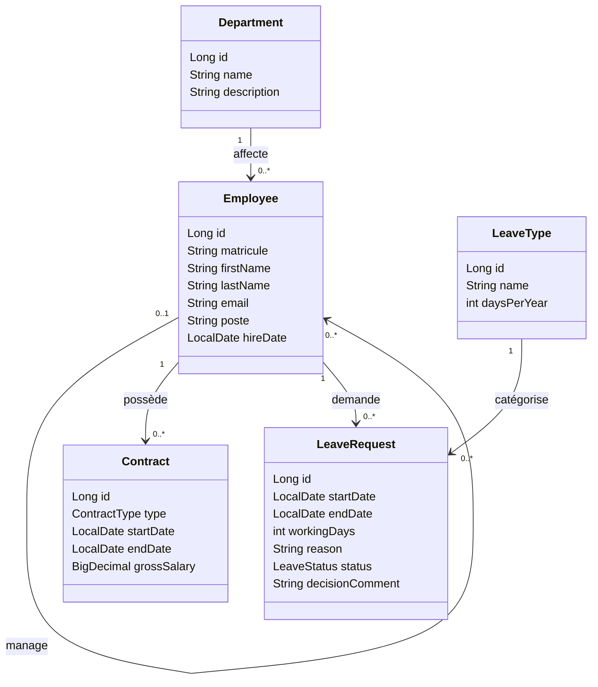

# AtlasRH — API de gestion des ressources humaines

AtlasRH est une API REST en Java destinée à centraliser la gestion RH d’une entreprise de 250 collaborateurs. Elle remplace progressivement les e-mails et les tableurs utilisés pour gérer les départements, les employés, les contrats et les congés.

> **État du projet :** la base contient l’application Spring Boot, les entités `Department`, `Employee` et `Contract`, ainsi que leurs migrations Liquibase. Les endpoints Responsable RH et les autres fonctionnalités du brief restent à développer.

## Objectifs fonctionnels

Le projet est développé en deux livrables :

### Livrable 1 — Responsable RH

- Gérer les départements : créer, modifier, consulter et supprimer un département. Le nom est unique et un département contenant des employés ne peut pas être supprimé.
- Gérer les employés : créer, modifier, consulter et rechercher des fiches, avec pagination et tri. Une fiche contient notamment un matricule, un nom, un prénom, un e-mail, un poste, une date d’embauche, un département et éventuellement un manager.
- Gérer les contrats : créer un contrat CDI, CDD ou STAGE, terminer un contrat en cours et consulter l’historique des contrats d’un employé.

### Livrable 2 — Manager et employé

- Le manager consulte les demandes en attente de son équipe et les approuve ou les refuse avec un commentaire. Un refus exige un commentaire.
- Un employé crée, consulte et annule ses demandes tant qu’elles sont en attente, et consulte son solde ainsi que son ancienneté.
- Les demandes sont calculées en jours ouvrés, dates comprises. Elles ne peuvent ni se chevaucher pour un même employé ni dépasser le solde disponible. Le solde est dérivé des jours annuels du type de congé moins les jours des demandes approuvées de l’année.

Les types de congé prévus sont le congé annuel et le congé exceptionnel. L’authentification n’est pas prévue dans cette V1 ; les profils RH, manager et employé organisent les fonctionnalités.

## Technologies

- Java 17 et Maven
- Spring Boot, Spring Web MVC et Spring Data JPA
- PostgreSQL et Liquibase
- Bean Validation
- API JSON ; DTO et MapStruct prévus pour séparer l’API des entités
- Swagger / OpenAPI prévu pour documenter les endpoints

## Prérequis

- JDK 17
- Docker avec Docker Compose, ou une instance PostgreSQL accessible
- Maven (ou le Maven Wrapper du projet)

## Lancer le projet

1. Démarrer PostgreSQL avec Docker Compose :

   ```bash
   docker compose up -d postgres
   ```

   La configuration Compose crée la base `atlasrh` avec l’utilisateur `atlasrh` et le mot de passe de développement `atlasrh_dev` sur le port `5432`.

2. Configurer la connexion à PostgreSQL dans `src/main/resources/application.yaml`. La configuration actuelle ne contient que le nom de l’application ; ajouter les paramètres suivants pour activer JPA et Liquibase :

   ```yaml
   spring:
     application:
       name: atlasrh
     datasource:
       url: jdbc:postgresql://localhost:5432/atlasrh
       username: atlasrh
       password: atlasrh_dev
     jpa:
       hibernate:
         ddl-auto: validate
       open-in-view: false
     liquibase:
       change-log: classpath:db/changelog/db.changelog-master.yaml
   ```

3. Lancer l’application depuis la racine du dépôt :

   ```bash
   ./mvnw spring-boot:run
   ```

   Sous Windows, utiliser `mvnw.cmd spring-boot:run`. Il est aussi possible d’utiliser `mvn spring-boot:run` si Maven est installé.

> Les migrations couvrent actuellement les départements, employés et contrats. Le schéma complet et les données de démonstration demandés par le brief ne sont pas encore implémentés. Les URL Swagger et les endpoints seront indiqués ici lorsqu’ils seront disponibles.

## Architecture en couches

Le code applicatif se trouve sous `src/main/java/com/atlasrh`. Les packages `controller`, `service`, `repository`, `dto` et `mapper` représentent l’architecture cible ; ils seront complétés au fil des fonctionnalités.

| Couche | Responsabilité | Convention |
| --- | --- | --- |
| `controller` | Exposer les endpoints REST, recevoir les DTO, retourner les codes HTTP adaptés. | Aucune règle métier dans les contrôleurs. |
| `service` | Appliquer les règles métier et coordonner les accès aux données. | Les entités restent dans les couches service et persistance. |
| `repository` | Accéder aux données avec Spring Data JPA. | Un repository par agrégat ou entité persistée. |
| `entity` | Décrire le modèle JPA et ses relations. | Une entité ne doit pas être retournée directement par l’API. |
| `dto` | Définir les formats d’entrée et de sortie de l’API. | Les DTO forment le contrat JSON de l’API. |
| `mapper` | Convertir les DTO en entités et inversement. | Utiliser MapStruct. |
| `exception` | Centraliser la traduction des erreurs en réponses HTTP. | Codes prévus : 400, 404 et 409 selon le cas. |
| `validation` | Regrouper les validations réutilisables. | Bean Validation pour les contraintes de données. |

Les noms de classes et propriétés sont en anglais, au singulier, en `UpperCamelCase` pour les classes et `lowerCamelCase` pour les propriétés et méthodes. Les réponses REST utilisent des DTO ; les entités ne sont jamais exposées directement.

## Modèle métier cible

Le modèle final comporte les cinq entités prévues par le brief :



Les cardinalités décrivent le modèle cible. La règle d’un seul contrat en cours par employé, les contraintes de dates et les règles de congés seront appliquées par la couche service et renforcées par les contraintes de persistance appropriées.

## Suivi des fonctionnalités

| Fonctionnalité | État |
| --- | --- |
| Entité `Department` et unicité du nom | Présente ; migration Liquibase disponible |
| Entité `Employee` et liens département / manager | Présente ; migration Liquibase disponible |
| Entité `Contract` et types CDI / CDD / STAGE | Présente ; migration Liquibase disponible |
| API Responsable RH (US1 à US3) | À développer |
| Contrats, congés et données de démonstration | À développer |
| API Manager et employé (US4 à US6) | À développer |
| Swagger, DTO, MapStruct et gestion centralisée des erreurs | À intégrer avec les endpoints |

## Améliorations prévues (bonus)

- E-mail à l’employé après approbation ou refus d’une demande.
- Consultation de l’organigramme hiérarchique.
- Audit automatique des dates de création et de modification avec JPA Auditing.
