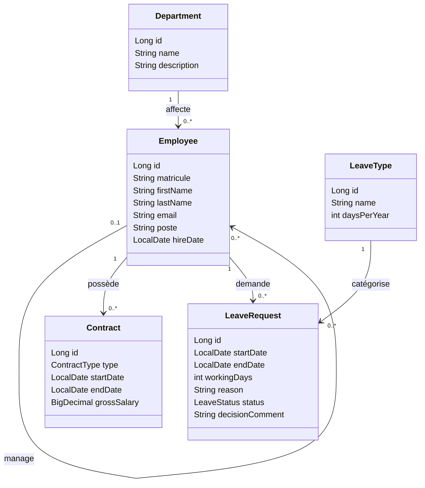

# AtlasRH — API de gestion des ressources humaines

AtlasRH est une API REST en Java destinée à centraliser la gestion RH d’une entreprise de 250 collaborateurs. Elle remplace progressivement les e-mails et les tableurs utilisés pour gérer les départements, les employés, les contrats et les congés.

> **État du projet :** les API RH, Employé et Manager sont implémentées. La compilation, les tests unitaires, le test HTTP de bout en bout, PostgreSQL, Liquibase, MapStruct et Swagger/OpenAPI ont été vérifiés.

## Objectifs fonctionnels

Le projet est développé en deux livrables :

### Livrable 1 — Responsable RH

- Gérer les départements : créer, modifier, consulter et supprimer un département. Le nom est unique et un département contenant des employés ne peut pas être supprimé.
- Gérer les employés : créer, modifier, consulter et rechercher des fiches, avec pagination et tri. Une fiche contient notamment un matricule, un nom, un prénom, un e-mail, un poste, une date d’embauche, un département et éventuellement un manager.
- Gérer les contrats : créer un contrat CDI, CDD ou STAGE, terminer un contrat en cours et consulter l’historique des contrats d’un employé.

### Livrable 2 — Manager et employé

- Le manager consulte les demandes en attente de son équipe et les approuve ou les refuse avec un commentaire. Un refus exige un commentaire.
- Un employé crée, consulte et annule ses demandes tant qu’elles sont en attente, et consulte son solde ainsi que son ancienneté.
- Les demandes sont calculées en jours ouvrés, dates comprises. Elles ne peuvent ni se chevaucher pour un même employé ni dépasser le solde disponible. Le solde est dérivé des jours annuels du type de congé moins les jours des demandes approuvées de l’année.

Les types de congé prévus sont le congé annuel et le congé exceptionnel. L’authentification n’est pas prévue dans cette V1 ; les profils RH, manager et employé organisent les fonctionnalités. Les identifiants transmis dans les URL ne sont pas des contrôles d’accès.

## Technologies

- Java 17 et Maven
- Spring Boot, Spring Web MVC et Spring Data JPA
- PostgreSQL et Liquibase
- Bean Validation
- API JSON ; DTO et MapStruct séparent l’API des entités
- Swagger / OpenAPI documente chaque route ; interface disponible sur `/swagger-ui/index.html`

## Prérequis

- JDK 17
- Docker avec Docker Compose, ou une instance PostgreSQL accessible
- Maven (ou le Maven Wrapper du projet)

## Lancer le projet

1. Démarrer PostgreSQL avec Docker Compose :

   ```bash
   docker compose up -d postgres
   ```

   La configuration Compose crée la base `atlasrh` avec l’utilisateur `atlasrh` et le mot de passe de développement `atlasrh_dev` sur le port `5432`. Si ce port est occupé, lancer `POSTGRES_PORT=55432 docker compose up -d postgres`, puis démarrer l’API avec `DB_URL=jdbc:postgresql://localhost:55432/atlasrh mvn spring-boot:run`.

2. Lancer l’application depuis la racine du dépôt :

   ```bash
   ./mvnw spring-boot:run
   ```

   Sous Windows, utiliser `mvnw.cmd spring-boot:run`. Il est aussi possible d’utiliser `mvn spring-boot:run` si Maven est installé.

Les endpoints RH sont accessibles sous `/api` :

| Méthode | Route | Fonction |
| --- | --- | --- |
| `GET`, `POST` | `/departments` | Lister et créer les départements |
| `GET`, `PUT`, `DELETE` | `/departments/{id}` | Consulter, modifier ou supprimer un département |
| `GET` | `/employees` | Rechercher et paginer (`q`, `departmentId`, `page`, `size`, `sort`) |
| `GET` | `/employees/{id}/team` | Consulter l’équipe d’un manager avec pagination |
| `GET`, `PUT`, `DELETE` | `/employees/{id}` | Consulter, modifier ou supprimer un employé |
| `POST` | `/employees` | Créer un employé |
| `POST` | `/contracts` | Créer un contrat CDI, CDD ou STAGE |
| `GET` | `/contracts/employee/{employeeId}` | Consulter l’historique des contrats d’un employé |
| `PATCH` | `/contracts/{id}/end` | Terminer un contrat (`endDate` facultatif, format `YYYY-MM-DD`) |
| `GET`, `POST`, `PUT` | `/leave-types`, `/leave-types/{id}` | Consulter et configurer les quotas annuels des congés annuel et exceptionnel |
| `POST`, `GET` | `/employees/{employeeId}/leave-requests` | Créer une demande et consulter l’historique de l’employé |
| `PATCH` | `/employees/{employeeId}/leave-requests/{requestId}/cancel` | Annuler une demande en attente |
| `GET` | `/employees/{employeeId}/leave-balance?year=2026` | Consulter le solde par type (année courante par défaut) |
| `GET` | `/employees/{employeeId}/seniority` | Consulter l’ancienneté calculée depuis la date d’embauche |
| `GET` | `/managers/{managerId}/leave-requests/pending` | Voir les demandes en attente de son équipe |
| `PATCH` | `/managers/{managerId}/leave-requests/{requestId}/decision` | Approuver ou refuser une demande de son équipe |

Les corps de création et modification utilisent les DTO du projet. Les deux types et quotas (`ANNUAL`, 22 jours ; `EXCEPTIONAL`, 3 jours) sont préchargés par Liquibase. Les jours ouvrés sont calculés du lundi au vendredi, dates comprises ; les jours fériés ne sont pas pris en compte. En V1, les routes reçoivent un `employeeId` et ne vérifient pas l’identité de l’appelant. Les erreurs sont renvoyées en JSON avec un statut adapté : `400` pour une requête invalide, `404` pour une ressource absente et `409` en cas de conflit métier.

## Architecture en couches

Le code applicatif se trouve sous `src/main/java/com/atlasrh`, organisé en packages `controller`, `service`, `repository`, `dto` et `entity`.

| Couche | Responsabilité | Convention |
| --- | --- | --- |
| `controller` | Exposer les endpoints REST, recevoir les DTO, retourner les codes HTTP adaptés. | Aucune règle métier dans les contrôleurs. |
| `service` | Appliquer les règles métier et coordonner les accès aux données. | Les entités restent dans les couches service et persistance. |
| `repository` | Accéder aux données avec Spring Data JPA. | Un repository par agrégat ou entité persistée. |
| `entity` | Décrire le modèle JPA et ses relations. | Une entité ne doit pas être retournée directement par l’API. |
| `dto` | Définir les formats d’entrée et de sortie de l’API. | Les DTO forment le contrat JSON de l’API. |
| `mapper` | Convertir les entités en DTO de réponse. | Les conversions sont des interfaces MapStruct générées à la compilation. |
| `exception` | Centraliser la traduction des erreurs en réponses HTTP. | Codes prévus : 400, 404 et 409 selon le cas. |
| `validation` | Regrouper les validations réutilisables. | Bean Validation pour les contraintes de données. |

Les noms de classes et propriétés sont en anglais, au singulier, en `UpperCamelCase` pour les classes et `lowerCamelCase` pour les propriétés et méthodes. Les réponses REST utilisent des DTO ; les entités ne sont jamais exposées directement.

## Modèle métier cible

Le modèle final comporte les cinq entités prévues par le brief :



Les cardinalités décrivent le modèle cible. La règle d’un seul contrat en cours par employé, les contraintes de dates et les règles de congés seront appliquées par la couche service et renforcées par les contraintes de persistance appropriées.

## Améliorations prévues (bonus)

- E-mail à l’employé après approbation ou refus d’une demande.
- Consultation de l’organigramme hiérarchique.
- Audit automatique des dates de création et de modification avec JPA Auditing.

## Essais Postman

Base URL : `http://localhost:8080/api`. Démarrage local : `docker compose up -d postgres`, puis `mvn spring-boot:run` (ou `./mvnw spring-boot:run` si le cache Maven est disponible). Aucune authentification n’est configurée. Les IDs ci-dessous sont des exemples : utilisez les IDs retournés par vos créations.

### Responsable RH

Créer un département — `POST /departments` :

```json
{"name":"Ressources Humaines","description":"Equipe RH"}
```

Réponse `201` :

```json
{"id":1,"name":"Ressources Humaines","description":"Equipe RH"}
```

Créer un employé — `POST /employees` :

```json
{"matricule":"ATL-001","firstName":"Sara","lastName":"Amrani","email":"sara.amrani@example.com","poste":"Responsable RH","hireDate":"2024-02-12","departmentId":1,"managerId":null}
```

Consulter/lister : `GET /departments`, `GET /departments/{id}`, `GET /employees?q=Sara&page=0&size=20&sort=lastName,asc`, `GET /employees?departmentId=1`, `GET /employees/{id}`, `GET /employees/{managerId}/team`. Modifier : `PUT /departments/{id}`, `PUT /employees/{id}` (mêmes corps que la création). Supprimer : `DELETE /departments/{id}`, `DELETE /employees/{id}`. Un département non vide ne peut pas être supprimé.

Créer un contrat — `POST /contracts` :

```json
{"type":"CDI","startDate":"2024-02-12","endDate":null,"grossSalary":18000.00,"employeeId":1}
```

Historique : `GET /contracts/employee/1`. Terminer : `PATCH /contracts/{contractId}/end?endDate=2026-10-30` (date facultative, aujourd’hui par défaut).

### Employé et congés

Les types sont créés par Liquibase : `GET /leave-types` devrait renvoyer `ANNUAL` (22 jours) et `EXCEPTIONAL` (3 jours). Créer une demande — `POST /employees/2/leave-requests` :

```json
{"leaveTypeId":1,"startDate":"2026-11-02","endDate":"2026-11-04","reason":"Démarches personnelles"}
```

Réponse type `201` (l’identifiant et le nombre de jours varient) :

```json
{"id":1,"employeeId":2,"leaveTypeId":1,"leaveType":"ANNUAL","startDate":"2026-11-02","endDate":"2026-11-04","workingDays":3,"reason":"Démarches personnelles","status":"EN_ATTENTE","decisionComment":null}
```

Lister toutes les demandes : `GET /employees/2/leave-requests`. Filtrer : `GET /employees/2/leave-requests?status=EN_ATTENTE` (valeurs : `EN_ATTENTE`, `APPROUVEE`, `REFUSEE`, `ANNULEE`). Annuler une demande en attente : `PATCH /employees/2/leave-requests/{requestId}/cancel`. Solde : `GET /employees/2/leave-balance?year=2026`. Ancienneté : `GET /employees/2/seniority`.

### Manager

Le manager est l’employé dont l’ID est dans `managerId` sur la fiche de l’employé. Voir les demandes en attente de son équipe : `GET /managers/1/leave-requests/pending`. Approuver : `PATCH /managers/1/leave-requests/{requestId}/decision` :

```json
{"approved":true,"comment":"Congé approuvé"}
```

Refuser (commentaire obligatoire) :

```json
{"approved":false,"comment":"Période incompatible avec les besoins de l’équipe"}
```

Réponses attendues : `201` création, `200` consultation/modification, `204` suppression, `400` validation/règle de date, `404` ressource absente, `409` conflit (unicité, chevauchement, solde ou état incompatible). Les dates doivent être au format `YYYY-MM-DD`.

## État d’avancement

| Sujet | État |
| --- | --- |
| API Responsable RH (US1–US3) | Implémentée et couverte par les règles de validation métier |
| API Employé (US5–US6) et Manager (US4) | Implémentées ; statut, dates, chevauchement, quotas et commentaire de refus appliqués |
| Recherche, pagination, tri, équipe manager | Implémentés, y compris filtre par département |
| PostgreSQL, migrations Liquibase, quotas et données fictives liées | Implémentés ; changelog testé avec PostgreSQL |
| DTO, MapStruct, erreurs JSON, Swagger/OpenAPI, logs SLF4J | Implémentés |
| Vérification | Compilation réussie ; 3 tests métier, 1 test API/PostgreSQL et 1 test de contexte réussis |
| Jira et présentation | Documents de préparation fournis dans `docs/` ; créer/importer les tickets dans le Jira de l’équipe et répéter la démonstration |
